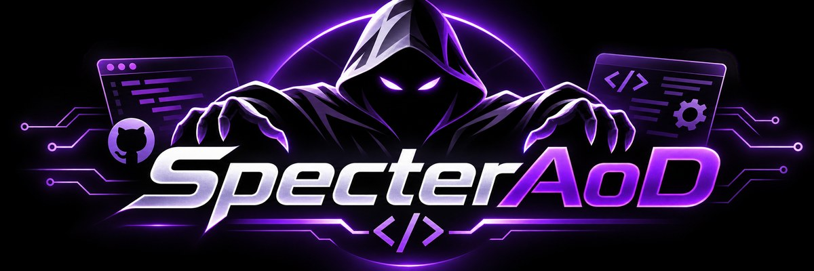

# Hi, I'm SpecterAoD

I build small, carefully documented tools – mostly in **Rust** and **C++** – around security,
embedded devices and home infrastructure. I prefer written specifications, signed commits and
honest limitations over big promises.

Current focus: **PQKeep**, a command-line tool for post-quantum key generation and storage
(ML-KEM, ML-DSA, AES-256-GCM, Argon2id) – in early development and not yet audited.

### How I work

- Every change starts with a short plan and ends with CI, tests and a signed commit.
- I develop together with an AI coding assistant (Claude by Anthropic) and say so in each
  project; design decisions, review and releases stay with me.
- Security issues: please use the private reporting link in the respective repository.

### Support

If my work is useful to you, you can buy me a coffee via
[GitHub Sponsors](https://github.com/sponsors/SpecterAoD) – entirely optional; bug reports, ideas
and contributions help just as much. *Wenn dir meine Arbeit nützt, freue ich mich über einen Kaffee
über GitHub Sponsors – ganz freiwillig.*

---

**Developed by SpecterAoD · Entwickelt von SpecterAoD**

